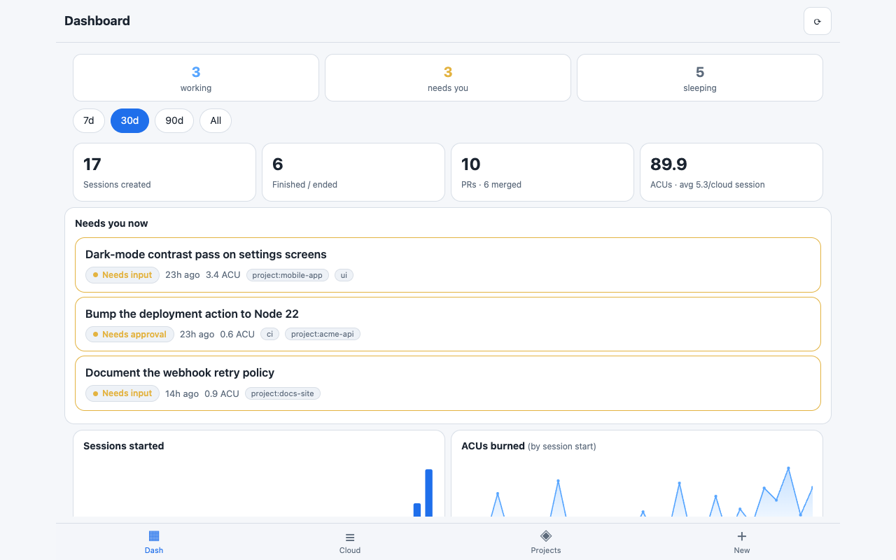
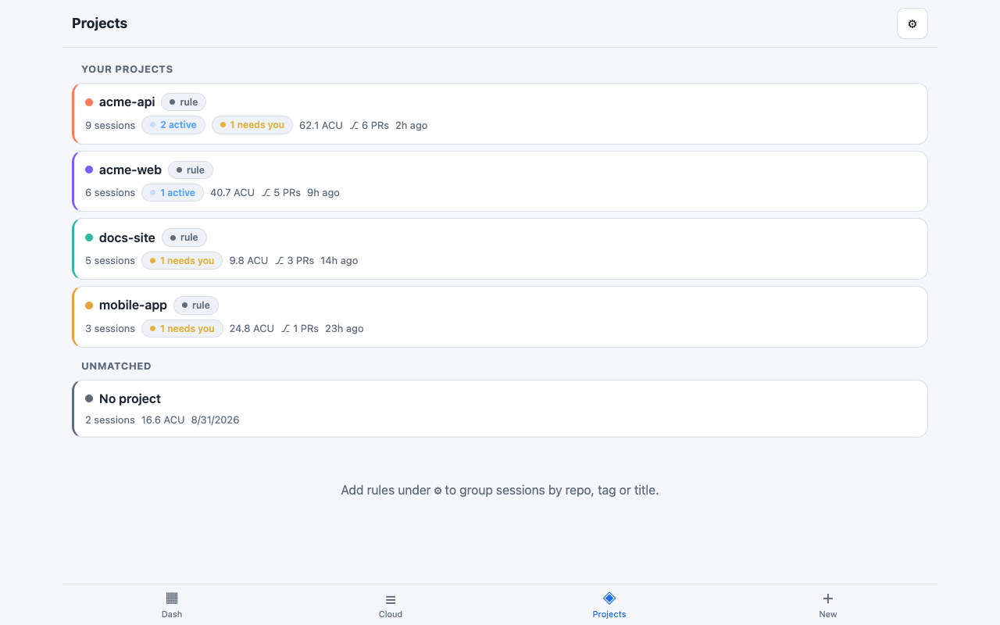
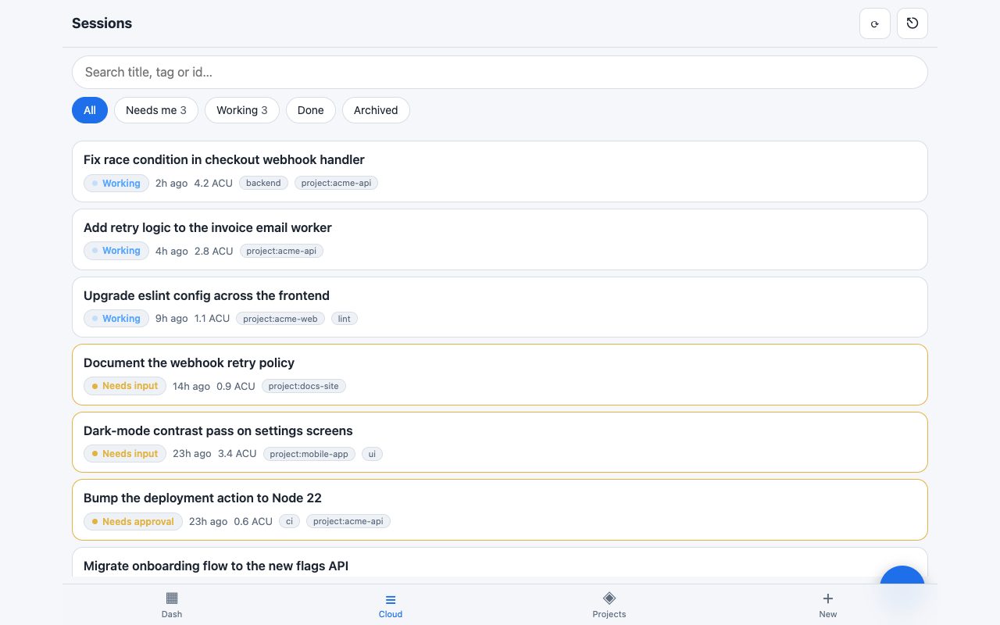
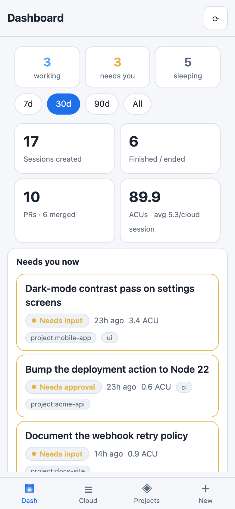

# Devin Control

Unofficial community project, not affiliated with or endorsed by Cognition. "Devin" is a trademark of Cognition.

A zero-dependency dashboard and control panel for your Devin sessions.
Install it on your phone's home screen or open it on the desktop.

## Quick start

```bash
git clone https://github.com/Munawarhussain729/devin-control.git
cd devin-control
cp .env.example .env   # then edit .env — see "Configure" below
node server.js
```

Open http://localhost:8787.

To try it without any Devin credentials, run `npm run demo` — it starts a
built-in mock API with invented data (demo password: `demo-password`).

## Requirements

- **Node 18+** for the cloud dashboard (uses the built-in `fetch`). No `npm install` needed — there are no dependencies.
- **Node 22.5+ and macOS** only for the optional, experimental [Local tab](#local-tab-experimental).

## Screenshots

| Dashboard | Projects | Sessions |
|---|---|---|
|  |  |  |

Mobile: 

## What you get

**Dashboard** — analytics across *all* your sessions (including archived):
- live pills: working now / needs you / sleeping (tap to jump into the list)
- KPIs per range (7d / 30d / 90d / all): sessions created, finished, PRs & merged PRs,
  ACUs burned, avg ACU/session, on-demand spend (Teams plans)
- charts: sessions started, ACU burn, current status mix, work type (category),
  top projects, session origins (web/slack/api/cli…), Devin modes
- "Needs you now" list of sessions waiting for input
- one-tap JSON export of the full synced dataset

**Projects** — every session grouped under a project:
- automatic groups from the repo in each session's PR urls
- your own rules: match on repo name, tag, or title substring (edit in-app, stored
  in `projects.json`), with custom colors
- per-project view: sessions, ACUs, PRs, spend, 30-day activity chart
- tag a session `project:name` from the session menu, or pick a project when
  starting a session (fills repos + tag for you)

**Sessions** (Cloud tab):
- list with live status, filters (needs me / working / done / archived) and search
- read the conversation, send messages (wakes sleeping sessions)
- sleep & archive, unarchive, terminate, edit tags, copy session id / Devin link
- start sessions: prompt, title, project picker, repos (datalist from your org),
  tags, mode, max ACUs

**Local tab** — opt-in and experimental; see [Local tab (experimental)](#local-tab-experimental).

Your Devin API key stays on the server. The browser only gets a password-protected,
signed session cookie.

## 1. Get Devin credentials

In Devin: **Settings > Devin API > Service users > Provision service user**.
Pick the **Member** role, copy the `cog_...` key (shown once), and note your
**Organization ID** shown at the top of that page.

## 2. Configure

```bash
cp .env.example .env
# edit .env: DEVIN_API_KEY, DEVIN_ORG_ID, APP_PASSWORD (8+ chars, make it long)
node server.js
```

Open http://localhost:8787 to check it works. Every variable is documented in
`.env.example`.

By default the server binds to **127.0.0.1** — only this machine can reach it.
To open the panel to your local network (for example, to use it from a phone on
the same Wi-Fi), set `HOST=0.0.0.0` in `.env`. Only do that behind HTTPS — see
the next section.

## 3. Reach it from your phone (needs HTTPS)

The app is useless on a phone if it only runs on your laptop, and cookies/installable-app features need HTTPS. Pick one:

**Cloudflare Tunnel (free, quickest if your machine stays on)**
```bash
cloudflared tunnel --url http://localhost:8787
```
Set `TRUST_PROXY=1` in `.env`, restart, open the printed https URL on your phone.
No `HOST` change needed — the tunnel forwards to localhost.

**Same Wi-Fi, no tunnel:** set `HOST=0.0.0.0` in `.env` and open
`http://<your-laptop-ip>:8787` on the phone. Note this is plain HTTP — anyone on
the network can see the login page and traffic. Prefer a tunnel.

**Small host (always on): Render, Railway, Fly.io, any VPS**
Deploy this folder (a `Dockerfile` is included). Set `DEVIN_API_KEY`, `DEVIN_ORG_ID`, `APP_PASSWORD` as environment variables on the host, and `TRUST_PROXY=1` (the Dockerfile already sets it). The Dockerfile also sets `HOST=0.0.0.0`, which is required inside a container for the port mapping to work.
Mount a volume at `/app/data` (or set `DATA_DIR`) so `projects.json` survives redeploys.

## 4. Install on your phone

- **iPhone (Safari):** Share > Add to Home Screen
- **Android (Chrome):** menu > Install app / Add to Home screen

## Local tab (experimental)

Set `ENABLE_LOCAL=1` in `.env` to show a fourth tab that indexes sessions
created in Devin Desktop / the Devin CLI on the machine where this server runs.
It is:

- **opt-in** — off by default; only the exact value `1` enables it
- **unofficial** — not supported by Cognition, built against undocumented
  on-disk formats that may change or break with any Devin update
- **local-only** — reads files on your own machine
  (`~/Library/Application Support/Devin/User/…` by default;
  `DEVIN_DESKTOP_DIR` overrides the path) and your Devin CLI login token from
  `~/.local/share/devin/credentials.toml` to authenticate `devin acp`
- **macOS paths by default** and needs **Node 22.5+** (`node:sqlite`)

When enabled it can list local sessions, show transcripts, and resume a session
by spawning `devin acp`. When disabled, the `/api/local/*` endpoints return 404
and none of those files are touched. If it stops working after a Devin update,
turn it off again — the cloud tabs are unaffected either way.

## How it works

- `GET /api/analytics` — the server walks every page of `GET /v3/organizations/{org}/sessions`
  (live + archived, up to 10k sessions each) and returns a compact payload, cached 60s.
  Add `?refresh=1` to bypass the cache. The dashboard/projects views slice it locally.
- `GET|POST /api/projects` — reads/writes `{projects: [{name, match[], color?}]}` in
  `DATA_DIR/projects.json` (default: app directory).
- `GET /api/repos` — org repository list (cached 10 min) for the repo pickers.
- `GET|POST|PUT /api/sessions/:id/tags` — session tag read/append/replace.
- `GET /api/sessions` — additionally proxies `category`, `repo_names`, `tags`,
  `session_ids`, `created_after/before`, `updated_after` filters.
- `GET /api/local/sessions` (ENABLE_LOCAL=1 only) — indexes local Devin Desktop/CLI
  sessions by joining `globalStorage/state.vscdb` (`windsurf.acp.*` keys) with the
  per-session ACP transcript databases in `acp-messages/*.db`. Read-only; cached
  30s; works while Devin is running (WAL-safe opens).
- `GET /api/local/sessions/:uuid` — parses a transcript db into a message list
  (user/agent/thought/tool_call/plan), text payloads only — no file contents or
  tool output blobs beyond titles.
- `POST /api/local/sessions/:id/prompt` — resumes the session via a spawned
  `devin acp` process (JSON-RPC stdio): `initialize` → `authenticate` (session
  token from `~/.local/share/devin/credentials.toml`) → `session/load` →
  `session/prompt`. One job per session; `session/update` notifications feed
  the live view. Locked (open-in-Desktop) sessions return a clear error.
- `GET /api/local/jobs/:id` — prompt job status, captured output and streamed
  messages.

## Security notes

- Anyone with the password can spend your Devin quota. Use a long, unique one. Login is rate limited (8 failures / 15 min / IP).
- Only a fixed set of endpoints is proxied; the browser cannot call anything else on the Devin API.
- Use a Member-role service user — the key inherits whatever it can do. If the key leaks, revoke it in Settings > Devin API.
- The default bind is `127.0.0.1`. If you set `HOST=0.0.0.0` or deploy it anywhere, put it behind HTTPS (`TRUST_PROXY=1` marks the cookie `Secure` through a proxy/tunnel; only enable it when a proxy actually sits in front, because login rate limiting then keys on the proxy-supplied `X-Forwarded-For`). Set `SESSION_SECRET` to a long random string.
- Don't commit `.env` or `projects.json`/`data/` (all gitignored).
- See [SECURITY.md](SECURITY.md) for how to report a vulnerability.

## Status and limitations

- Single-user, single-organization. One password protects everything.
- Polling only (4s in a session, 15s on the list, 60s on the dashboard) — no push
  notifications; nothing runs in the background.
- Uses Devin API v3; it may break if the API changes.
- "Terminate" is permanent; "Sleep & archive" is reversible, and sending a message
  to a sleeping session resumes it.
- Approving a "waiting for approval" action isn't exposed by the session API, so
  the app tells you and links you to the Devin web app for that.
- History beyond 10,000 live + 10,000 archived sessions is marked "truncated" in
  the footer.
- Provided as-is, with no warranty (MIT license).

---

Maintained by Munawar Hussain. Issues and pull requests welcome.
